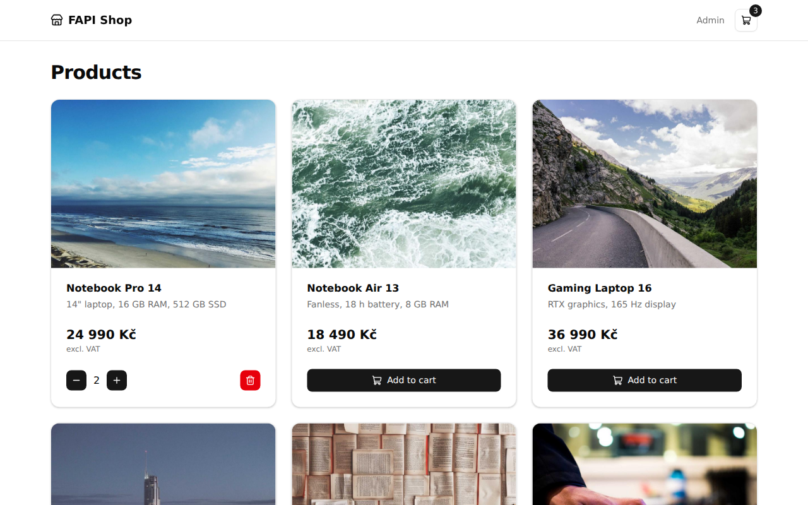
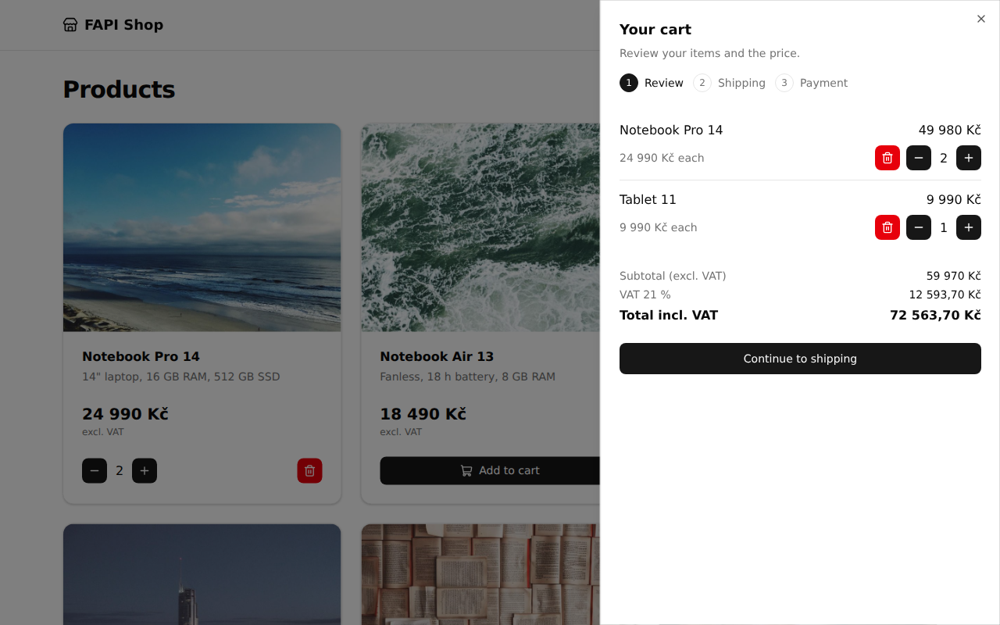
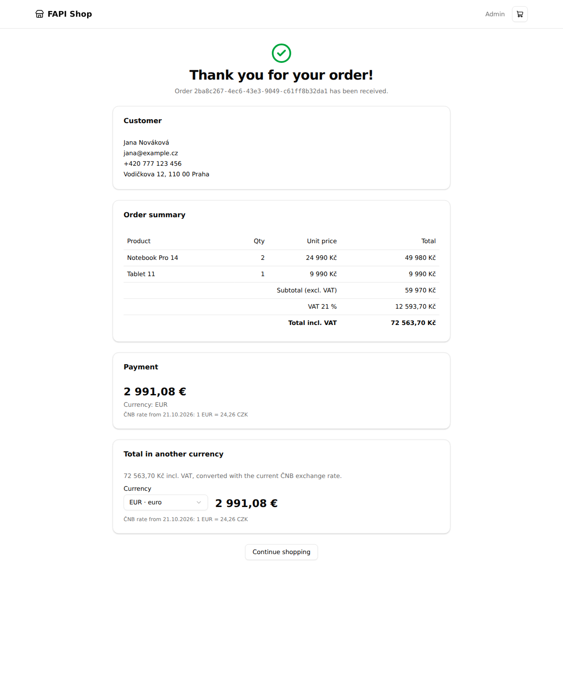
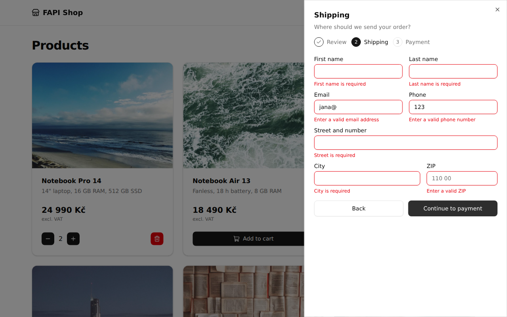
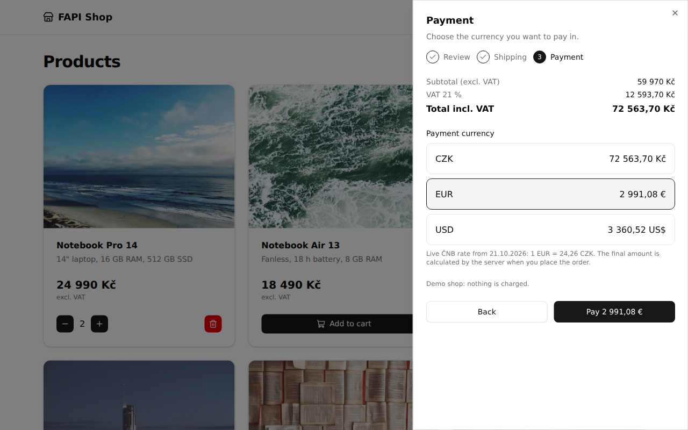
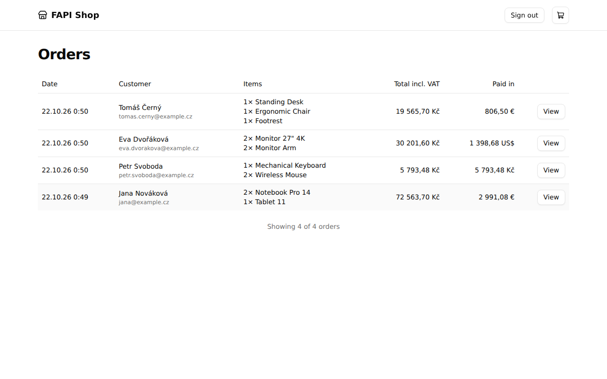
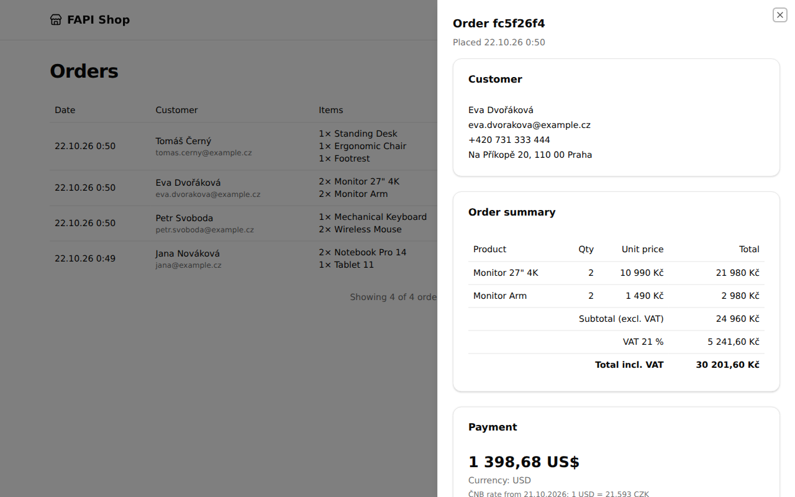
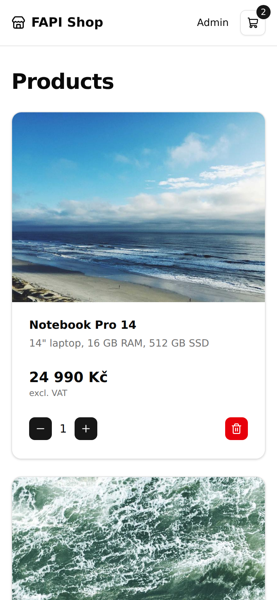
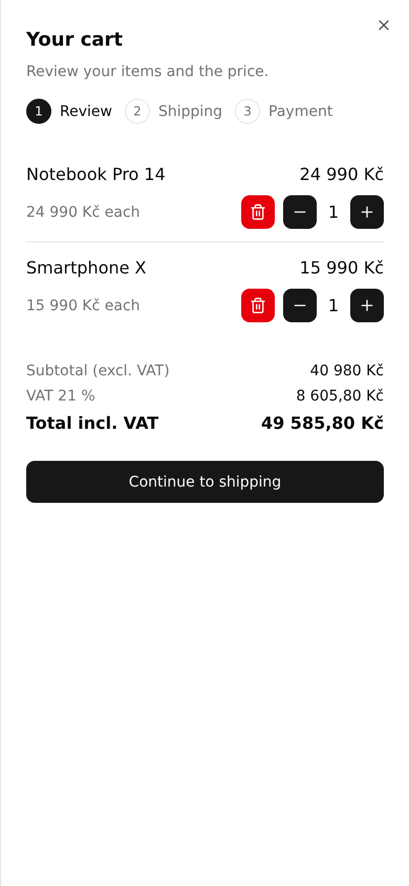

# FAPI order system

A small order system built as the second-round assignment for a FAPI programmer position: a shop with a cart, a 3-step checkout, a thank-you page with live ČNB currency conversion, and an admin page.

> [!NOTE]
> **A note on AI (EN)**
>
> We are living in 2026. AI is useful, I use it every day, and it has become a new instrument for writing code. In the hands of a junior programmer it is dangerous; in the hands of a senior, experienced programmer it is an amazing thing to have.
>
> This whole project was built with AI, using the right prompts, and I knew exactly what I was doing: I defined the stack, the languages and the infrastructure myself (see [PROMPT.md](PROMPT.md)).
>
> It may look vibe-coded. It is not. I used less than 1% of what I know (my workflow, my knowledge, my experience) and spent less than 2 hours from the first prompt to a working app. This is what I can do with minimum effort. Imagine what I can do with medium or maximum effort and enough time on big production projects.

> [!NOTE]
> **Poznámka k AI (CZ)**
>
> Žijeme v roce 2026. AI je užitečná, používám ji každý den a stala se novým nástrojem pro psaní kódu. V rukou juniorního programátora je nebezpečná, v rukou seniora se zkušenostmi je to úžasná věc.
>
> Celý tento projekt vznikl s pomocí AI a správných promptů a přesně jsem věděl, co dělám: stack, jazyky i infrastrukturu jsem si určil sám (viz [PROMPT.md](PROMPT.md)).
>
> Může to vypadat jako „vibe coding“, ale není. Využil jsem méně než 1 % toho, co umím (svůj postup, znalosti a zkušenosti) a od prvního promptu k funkční aplikaci jsem potřeboval méně než 2 hodiny. Tohle je ukázka toho, čeho dokážu dosáhnout s minimálním úsilím. Představte si, co zvládnu při středním nebo maximálním nasazení a s dostatkem času na velkých produkčních projektech.



## Run it

You only need Docker.

```bash
docker compose up      # or: make dev
```

| What       | URL                                                |
| ---------- | -------------------------------------------------- |
| Shop (web) | http://localhost:5173                              |
| API        | http://localhost:3000/api                          |
| Admin      | http://localhost:5173/admin (`admin` / `password`) |

Source is bind-mounted and both servers reload on change. The SQLite database lives in a Docker volume and is seeded with 50 products on first start.

| Command       | What it does                                                                                 |
| ------------- | -------------------------------------------------------------------------------------------- |
| `make dev`    | start API + web with live reload                                                             |
| `make test`   | run all tests in a throwaway container                                                       |
| `make lint`   | Biome + TypeScript                                                                           |
| `make doctor` | React Doctor score (100/100)                                                                 |
| `make format` | apply Biome formatting                                                                       |
| `make clean`  | remove containers and volumes (database, `node_modules`); run it after changing dependencies |

Without Docker: install [Bun](https://bun.sh) 1.4+ and Node 22, then `bun install`, `bun run dev:api` and `bun run dev:web`.

**Environment variables**

| Variable                        | Default                 |                                                                                                                                                                              |
| ------------------------------- | ----------------------- | ---------------------------------------------------------------------------------------------------------------------------------------------------------------------------- |
| `PORT`                          | `3000`                  | API port                                                                                                                                                                     |
| `DB_PATH`                       | `./data/shop.db`        | SQLite file                                                                                                                                                                  |
| `ADMIN_USER` / `ADMIN_PASSWORD` | `admin` / `password`    | admin login (the assignment's demo credentials)                                                                                                                              |
| `TRUST_PROXY`                   | unset                   | number of trusted reverse proxies (`true` = 1, as on Railway); rate limits then key on the client IP from `X-Forwarded-For`. Unset, the header is ignored (it can be forged) |
| `WEB_DIST`                      | unset                   | directory of the built web app; set in the production image so the API serves it                                                                                             |
| `API_PROXY_TARGET`              | `http://localhost:3000` | where the Vite dev server proxies `/api`                                                                                                                                     |
| `ALLOWED_HOSTS`                 | unset                   | extra host names the Vite dev server accepts, comma separated (e.g. a tunnel name)                                                                                           |

## The assignment, point by point

<details>
<summary><b>1. Order page</b>: customer details, product choice, quantity, automatic total, submit</summary>


- The shop is a product grid (3 columns on desktop, 2 on tablets, 1 on phones) with 50 products, 12 at a time and a **Load more** button. Prices come from the API.
- **Add to cart** turns into a quantity stepper (`− 2 +`, with a red remove button). `−` at 1 removes the item.
- The cart icon in the header shows the item count and opens a side **sheet** (full screen on phones) with a 3-step checkout: **Review** (items, quantities, net price, VAT, total, recalculated on every change), **Shipping** (customer details) and **Payment** (currency).
- The cart is kept in `localStorage` (zustand), so a refresh does not lose it. Its prices are checked against the API when the cart opens and again right before paying; if a price changed or a product is gone, nothing is sent and the cart shows what changed until the customer confirms the new total.
- The order is created by the **API**, never by the browser, and the server ignores any price sent by the client: it reads prices from the database and stores a snapshot of each line.

Code: `apps/web/src/widgets/cart-sheet`, `features/place-order`, `features/cart-quantity`, `entities/cart`, `apps/api/src/modules/orders`.
</details>

<details>
<summary><b>2. Thank-you page</b>: order recap, price including VAT, conversion at the current ČNB rate</summary>


- After the order is saved the browser is redirected to `/thank-you/<order id>`. The id is a random UUID, so the link cannot be guessed.
- The page shows the customer, every line, the net total, the 21 % VAT and the total including VAT, the **payment** the customer chose (currency, amount, the ČNB rate and its date), and a converter that shows the total in **any currency published by ČNB** at the current rate.
- The same details are shown to the admin (point 9 below).

Code: `apps/web/src/pages/thank-you`, `widgets/order-recap`, `entities/order/ui/OrderDetails.tsx`, `features/currency-converter`.
</details>

<details>
<summary><b>3. Automated functional test</b></summary>

`make test` runs the whole suite (Vitest). The functional tests drive the real HTTP layer of the app (Hono's `app.request`) against an in-memory SQLite database with the real migrations, so they exercise routing, validation, pricing, persistence and serialisation together, without a network:
- `apps/api/src/modules/orders/orders.test.ts`: create an order, check that the server computed prices, VAT and the payment currency itself (client prices ignored), read it back by id, list it in the admin, validation errors per field, empty cart, unknown product, missing order.
- `apps/api/src/modules/products`, `rates`, `admin`: pagination, ČNB failures (502, stale cache), Basic auth.
- `packages/shared`: VAT and FX maths, the ČNB parser, the zod schemas.
- `apps/api/src/db/migrations.test.ts`: upgrading a database that already holds orders through every migration.
- `apps/web` (Vitest + jsdom + Testing Library): the whole checkout from the product grid through the sheet, retries reusing the idempotency key (also after Back/forward and a reload), the cart locked while an order is placed, price changes found before paying, request timeouts, the currency converter, admin login with non-ASCII credentials, pagination and its refresh budget, signing out.

The same checks run on every push in GitHub Actions (see below).
</details>

<details>
<summary><b>4. Bonus</b>: <code>docker-compose up</code> and a Makefile with <code>make dev</code> / <code>make test</code></summary>

- `docker-compose.yml` starts `api` (:3000) and `web` (:5173); the web container proxies `/api` to the API container.
- `Dockerfile.dev` is based on Node 22 and adds **Bun** (pinned to 1.4.3) for installing dependencies and running scripts. Only the manifests and `bun.lock` are copied into the image, so the dependency layer is cached; the source is bind-mounted.
- `Makefile`: `dev`, `down`, `logs`, `test`, `lint`, `format`, `doctor`, `clean`.
</details>

<details>
<summary><b>5. Form validation</b> (email, phone, ...)</summary>


- One **zod** schema (`packages/shared/src/schemas.ts`) is used by both the form (TanStack Form) and the API (Hono zod validator), so the browser and the server can never disagree.
- Rules: required names, street and city; valid email; phone with 9-15 digits (optionally `+`, at most 20 characters); Czech ZIP (`110 00`); 1-99 pieces per product (counted after merging duplicate lines); at most 50 lines.
- The server answers invalid input with `422` and a per-field `issues` list.
- Each field reserves one line for its message, so showing an error never moves the layout.
</details>

<details>
<summary><b>6. Redirects between pages</b></summary>

- `/` (shop) → place the order → `/thank-you/<id>` (TanStack Router, `navigate` after the API confirmed the order). The cart is cleared and the sheet closes.
- `/thank-you/<id>` → **Continue shopping** → `/`. An unknown id shows a friendly message and a link back.
- `/admin` shows a login form; after signing in it lists the orders. While signed in, the header has a "Sign out" button (on the admin page it replaces the "Admin" link).
- A wrong password, or a lockout after repeated failures, returns to the login form with a message.
</details>

<details>
<summary><b>7. VAT calculation</b></summary>

- VAT is 21 % of the **net** price: `vat = round(subtotal × 21 / 100)`, `total = subtotal + vat`.
- All money is stored and calculated as **integer minor units** (haléře), never floats. Field names end in `Minor`.
- One function (`calcTotals` in `packages/shared/src/pricing.ts`) is used by the cart screen and by the server, which stores net, VAT and total with the order. Unit tests cover rounding.
- Currency conversion is exact integer arithmetic too (the ČNB rate as a whole number of thousandths) and rounds once, half up, to the currency's smallest unit: cents for EUR/USD payments, and each currency's own decimals in the thank-you converter (3 for TND, 0 for JPY).
</details>

<details>
<summary><b>8. ČNB integration</b>: live exchange rates, used at checkout and on the thank-you page</summary>


- The API reads ČNB's public daily file (`denni_kurz.txt`), parses it strictly (`packages/shared/src/cnb.ts`) and caches it for an hour. A response is only accepted if it is well-formed: a real date on the first line, exactly the column header `země|měna|množství|kód|kurz`, every row with 5 fields, a 3-letter code, a positive whole amount and a positive rate with at most 3 decimals, no duplicate codes, and EUR and USD present (other currencies may come and go, as ČNB adds and drops them).
- If ČNB is unreachable or sends bad data, it is left alone for a minute: the last good rates are served meanwhile, or, if there are none yet, `/api/rates` answers `502` straight away without asking ČNB again (the UI says so, while CZK still works). Concurrent refreshes share one request.
- **Payment step:** the customer picks **CZK, EUR or USD**. The screen shows the total in each currency using the live rate (`quotePayment`, shared code).
- When the order is placed, the **server** looks up the rate itself and calculates the amount; it stores the currency, the exchange rate, the rate's date and the amount with the order. Nothing the browser sends about money is trusted.
- The thank-you page and the admin show exactly what was stored.
- The thank-you page also has a converter for every currency in the ČNB file.
</details>

<details>
<summary><b>9. Admin page</b> (view orders, basic auth)</summary>



- `GET /api/admin/orders` is protected with HTTP Basic auth (`admin` / `password` by default, set `ADMIN_USER` / `ADMIN_PASSWORD`). Credentials are compared in constant time.
- The server sends no `WWW-Authenticate` header, so the browser does not pop up its native dialog; the SPA has its own login form.
- The table lists date, customer, items, total and what was paid (currency and amount), 20 orders at a time with **Load more**. **View** opens a sheet with the same details the customer sees: customer, lines, VAT and the payment with its stored rate.
- The list refreshes itself every 30 s, less often as more pages are loaded, so it always stays well inside the API's admin rate limit; beyond 30 pages it stops and offers a **Refresh** button instead.
</details>

## More than the assignment

- **Responsive**, with the cart and the admin detail as sheets (full screen on phones).

<p>
  
  
</p>

- **Loading states** (skeleton cards, spinners) and server-side pagination of products.
- **REST API** for products, prices, orders and rates:

| Method | Path                         |                                                            |
| ------ | ---------------------------- | ---------------------------------------------------------- |
| `GET`  | `/api/products?limit&offset` | page of products with prices                               |
| `GET`  | `/api/products?ids=1,2,3`    | current data of up to 50 products (the cart's price check) |
| `GET`  | `/api/products/:id`          | one product                                                |
| `POST` | `/api/orders`                | create an order (server prices it)                         |
| `GET`  | `/api/orders/:id`            | one order (unguessable UUID)                               |
| `GET`  | `/api/rates`                 | current ČNB rates                                          |
| `GET`  | `/api/admin/orders`          | orders for the admin (Basic auth)                          |
| `GET`  | `/api/health`                | health check                                               |

## Production

`Dockerfile` builds one image: the web app is compiled with Vite and the API serves it next to `/api` (with an SPA fallback), so there is one URL and no CORS. SQLite lives on a volume mounted at `/data`. `railway.json` points Railway at this Dockerfile and at `/api/health`.

```bash
docker build -t fapi-demo .
docker run -p 3000:3000 -v fapi-data:/data fapi-demo   # http://localhost:3000
```

On Railway: one service from this repo, a volume mounted at `/data`, and `TRUST_PROXY=true`.

## Security notes

- **Money is server-authoritative.** Prices, VAT, the exchange rate and the amount to pay are computed on the server; nothing the browser sends about money is trusted.
- **The customer pays what they saw.** The checkout sends the total it showed (`expectedTotalMinor`); if a price changed in the meantime the server answers `409` with `code: "price_changed"` and saves nothing, and the cart shows the new prices for the customer to confirm.
- **Orders are idempotent.** Each checkout attempt carries a random v4 UUID that is unique in the database. The browser keeps it, with the order it belongs to (shipping details and currency), in `sessionStorage` until the order succeeds, so a retry after a lost response, after going Back and forth, or after a reload sends the same request and gets the order that was already created instead of a second one. The key is bound to a hash of the request: reusing it for a different order answers `409` with no order data, so a key can never be used to read someone else's order.
- **Limits.** At most 99 pieces of one product per order (counted after merging duplicate lines), 32 KB request bodies, order submissions and admin requests are rate limited per client (IPv6 clients per /64), and repeated failed admin logins are locked out for a minute (`429` with `Retry-After`). The limiter is in memory with bounded, constant-time eviction.
- **Errors.** Malformed requests get `4xx` JSON, never a `500`; unexpected errors are logged and answered with a generic message.
- **Admin auth** is HTTP Basic over HTTPS (Railway terminates TLS; never use it over plain HTTP on an untrusted network). Credentials are UTF-8, compared in constant time, and never logged. The browser keeps the header in `sessionStorage` only for the tab's lifetime; a production system should use an `HttpOnly` session cookie instead.
- **Order links** (`/thank-you/<uuid>`) are unguessable but show the customer's details to anyone who has the link; responses are `Cache-Control: no-store`. Use fake data in the demo.
- **Injection.** All queries are parameterised (Drizzle) and React escapes every customer-supplied string.
- **ČNB data is validated** (date, the exact column header, 3-letter codes, positive amounts and rates with at most 3 decimals, no duplicate codes, EUR and USD present) before it replaces the cached rates.
- **The browser validates the API too.** Every response is parsed with the shared zod schemas, so unexpected data becomes a readable error instead of a broken page, and every request has a 15 s timeout.

## Quality

- **Biome** for linting and formatting (`make lint`, `make format`).
- **React Doctor 100 / 100** (`make doctor`), without disabling any rule.
- **GitHub Actions** (`.github/workflows`): `CI` runs Biome, the type check and the tests; `React Doctor` runs on every push to `master` and prints its report in the run (log and job summary), failing on any warning.
- Strict TypeScript everywhere (`strict`, `noUncheckedIndexedAccess`), no `any`, no non-null assertions, no lint suppressions. API response types are inferred from the same zod schemas that validate them.

## Project structure

```
apps/api            Hono + Drizzle + better-sqlite3 (run with tsx)
  drizzle/          generated SQL migrations (applied at startup)
  src/modules/      products, orders, rates, admin
  src/db/           schema, client, seed
apps/web            Vite + React 19 + Tailwind v4 + shadcn, Feature-Sliced Design
  src/app           providers and TanStack Router routes
  src/pages         shop, thank-you, admin
  src/widgets       header, product-grid, cart-sheet, order-recap, admin-orders
  src/features      add-to-cart, cart-quantity, place-order, currency-converter, admin-auth
  src/entities      product, cart, order, exchange-rate
  src/shared        api client, ui (shadcn), lib
packages/shared     zod request and response schemas, types, VAT + FX maths, ČNB parser, formatters (api and web)
docs/screenshots    images used by this README
```

## Decisions

- **Hono** instead of Express: small, typed, built on web standards, and `app.request()` makes real HTTP-level tests trivial.
- **Drizzle + SQLite**: typed queries, plain SQL migrations, no server to run for a demo.
- **`packages/shared`**: schemas, VAT and FX maths exist once and are used by both sides.
- **TanStack Router / Query / Form + zod** instead of react-router and react-hook-form.
- **Feature-Sliced Design** keeps the frontend layered: pages → widgets → features → entities → shared.
- **Bun** installs and runs the scripts; Node still runs Vite, tsx, Vitest and the native SQLite addon.
- **Server-authoritative money**: prices, VAT, exchange rate and the amount to pay are all computed on the server.
